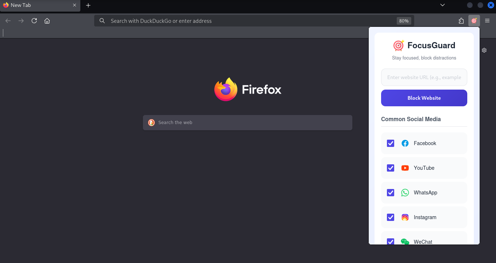
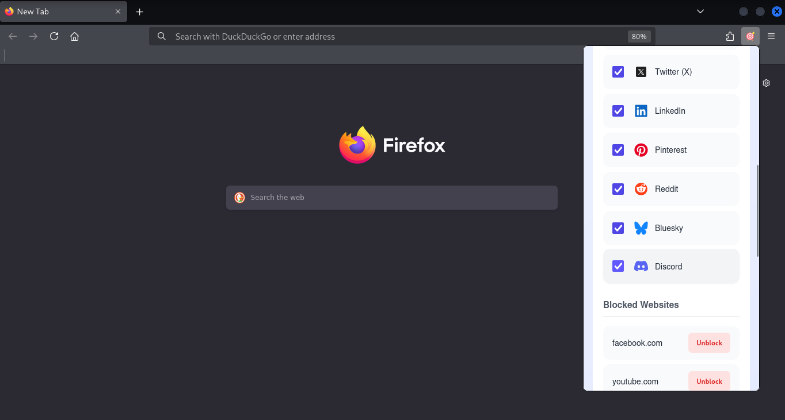

# FocusGuard

FocusGuard is a Firefox extension that blocks distracting websites and helps you track your focus. It supports Firefox desktop and Firefox for Android.

## Features

- **Website blocking:** Block custom domains and their subdomains.
- **Predefined sites:** Quickly select common social media websites.
- **Global On/Off switch:** Pause blocking without deleting your saved sites.
- **Productivity dashboard:** View all-time blocked attempts and estimated time saved.
- **Focus timer:** Start sessions lasting 1–180 minutes, with a default of 25 minutes.
- **Persistent progress:** Settings, statistics, and session timestamps are saved locally.
- **Live updates:** Blocking state and dashboard information synchronize between open extension views.
- **Android support:** Manage blocking and view the dashboard through the options page.

## How to Use

1. Open FocusGuard from the Firefox toolbar.
2. Select predefined websites or enter a custom website to block.
3. Use the global switch to pause or resume blocking.
4. Review your statistics or start a focus session.

On Android, the toolbar action opens the options page instead of a popup. Default social sites are initialized only when no saved blocked-site list exists. Existing choices are preserved.

Blocking applies to selected domains during page navigation. Reload an already-open page to apply updated rules.

## Understanding the Dashboard

- **Blocked attempts:** Each cancelled page-navigation request adds one attempt. Browser retries may add further attempts.
- **Estimated time saved:** A fixed estimate of five minutes per blocked attempt.
- **Session progress:** Tracks elapsed time against your selected session duration.

Statistics are all-time totals. The focus timer operates independently of blocking: pausing blocking does not stop the timer, and completing a session does not disable blocking.

## Data and Privacy

FocusGuard stores blocked sites, blocking state, aggregate statistics, session timestamps, and Android initialization settings in `browser.storage.local`.

This data stays in your local Firefox profile. The extension does not transmit it to external servers.

## Development Installation — Firefox Desktop

1. Download or clone this repository, including the `icons` directory.
2. Open `about:debugging` in Firefox.
3. Select **This Firefox** → **Load Temporary Add-on**.
4. Select the project's `manifest.json`.
5. Open FocusGuard from the toolbar.

After editing files, reload the extension from `about:debugging` and reopen its popup. Temporary installations must be loaded again after restarting Firefox.

Use a current Firefox release. Compatibility with older versions should be tested before claiming support.

## Screenshots

## Contributing

See [Contributing Guidelines](contribution.md) for setup instructions, testing expectations, and pull-request guidance.

## License

FocusGuard is available under the [MIT License](LICENSE).